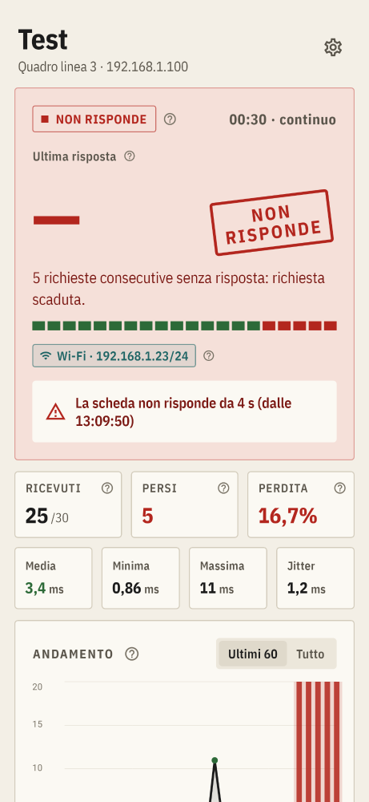
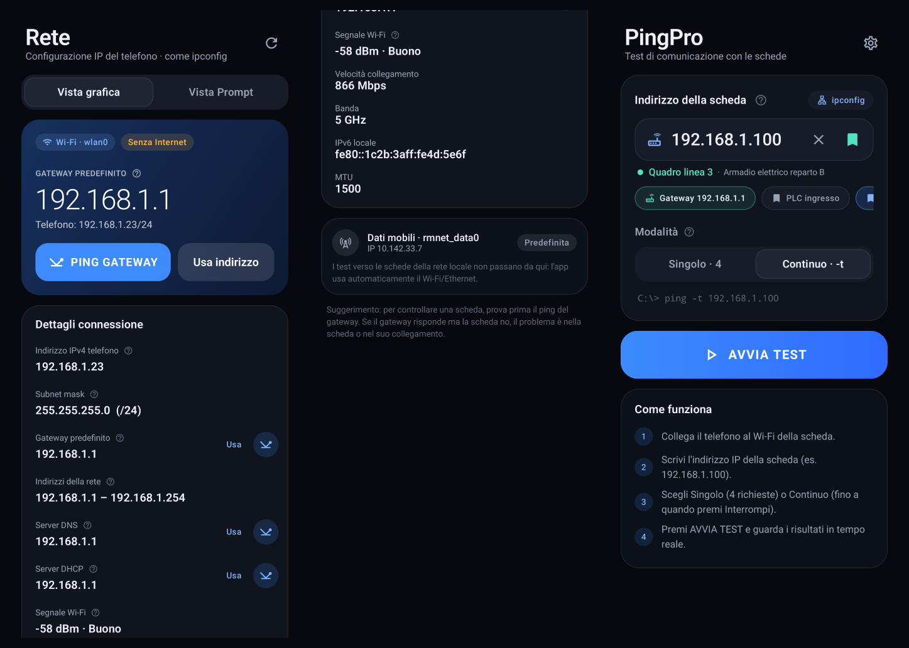
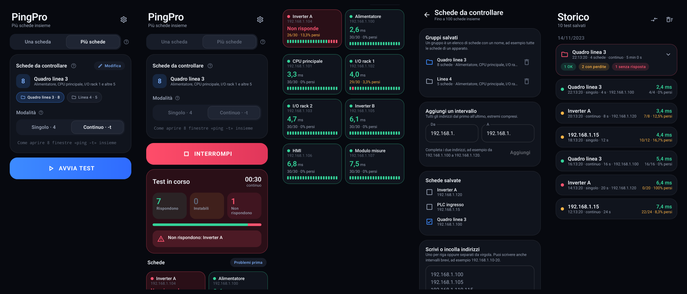
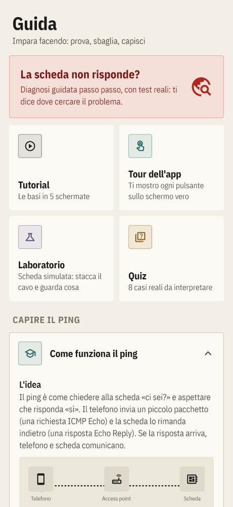

# PingPro – il PING di Windows, sul telefono

App Android per verificare la comunicazione con le schede elettroniche in rete, con le stesse
richieste **ICMP Echo** del comando `ping` di Windows, eseguite **realmente dal telefono** sulla
rete Wi-Fi/Ethernet a cui è collegato.









---

## 1. Installazione sul Samsung Galaxy (S26 Ultra o altri)

1. Scarica sul telefono il file **[`release/PingPro-1.3.0.apk`](release/PingPro-1.3.0.apk)**
   (da GitHub: apri il file → pulsante **Download raw file**).
2. Apri il file scaricato (dalla notifica del download oppure da **Archivio › Download**).
3. Alla prima installazione Android chiede di autorizzare la fonte:
   **Impostazioni › Installa app sconosciute › consenti** per l'app con cui hai aperto il file
   (es. *Archivio* o *Chrome*). Poi torna indietro e tocca **Installa**.
4. Se compare un avviso di **Google Play Protect** ("app non verificata"), tocca
   **Altri dettagli › Installa comunque**: è normale per le app installate fuori dal Play Store.
   Su One UI recenti può essere necessario disattivare temporaneamente
   **Impostazioni › Sicurezza › Auto Blocker** (Blocco automatico).
5. Apri **PingPro**. Al primo test l'app chiede il permesso per le **notifiche**: consentilo, così il
   test continuativo resta visibile e attivo anche con lo schermo spento.

Requisiti: Android 8.0 o superiore.

## 2. Uso in 4 passi

1. Collega il telefono al **Wi-Fi della scheda** (anche se quella rete non ha Internet).
2. Tocca **Gateway …** per usare il gateway predefinito (come lo trovi con `ipconfig`), scegli una
   scheda salvata oppure scrivi l'**indirizzo IP** (es. `192.168.1.100`).
3. Scegli **Singolo** (= `ping 192.168.1.100`, 4 richieste) o **Continuo** (= `ping -t 192.168.1.100`).
4. Premi **AVVIA TEST**. Per fermare premi **INTERROMPI** (anche dalla notifica).

Lo stato diventa **verde** se la scheda risponde, **giallo** se ci sono rallentamenti o perdite,
**rosso** se non risponde (2 richieste consecutive senza risposta): in quel caso il telefono vibra.

Nella sezione **Guida** dell'app trovi il tutorial, la spiegazione di ogni valore, esempi di
risultati normali e anomali e una lista di controlli quando la scheda non risponde. Ogni riquadro
ha un'icona **?** con una spiegazione breve.

## 3. Funzioni

| Funzione | Dettaglio |
|---|---|
| Test singolo / continuativo | Equivalenti a `ping` e `ping -t` |
| **Più schede insieme** | Fino a 100 schede in parallelo, ognuna con il proprio ping (come più finestre `ping`/`ping -t` aperte insieme). Elenco da schede salvate, intervallo di indirizzi o testo incollato (anche `192.168.1.10-20`); gruppi salvati con il nome dell'apparato; contatori rispondono/instabili/non rispondono, schede con problemi in cima, dettaglio per scheda; riepilogo copiabile/esportabile; nello storico un blocco unico per test |
| **Rete (ipconfig)** | IPv4 del telefono, subnet mask, **gateway predefinito**, intervallo indirizzi della rete, DNS, server DHCP, segnale/velocità/banda Wi-Fi, MTU. Pulsante **PING GATEWAY**, vista "Prompt" identica a `ipconfig` / `ipconfig /all` copiabile |
| Risultati in tempo reale | Latenza attuale, media, minima, massima, jitter, inviati, ricevuti, persi, % perdita |
| Stato connessione | Online / Lenta / Instabile / **Non risponde** con avviso a vibrazione (e suono opzionale) |
| Grafico latenza | Linea + media, barre rosse per i pacchetti persi, zone rosse per le interruzioni |
| Mappa pacchetti | Ultimi 40 pacchetti come quadratini colorati |
| Cronologia eventi | Inizio/fine, pacchetti persi, interruzioni con durata, ripristini, picchi di latenza |
| Schede salvate | Nome personalizzato + IP + note, avvio test con un tocco, esito dell'ultimo test |
| Storico | Ogni test salvato automaticamente, con grafico, eventi e tutti i pacchetti |
| Confronto | Due test affiancati: grafico sovrapposto e valori con evidenziato il migliore |
| **Guida interattiva** | Diagnosi guidata con test reali (rete del telefono → indirizzo → gateway → scheda → conclusione), tour sullo schermo vero, Laboratorio con scheda simulata (dichiarata come tale), quiz con 8 casi, animazione del viaggio del pacchetto, glossario e icone «?» ovunque |
| Esportazione | Report testuale nello stesso formato del Prompt di Windows, oppure CSV per Excel |
| Copia negli appunti | Report pronto da incollare in e-mail / chat |
| Ripeti | Rilancia lo stesso test dallo storico o a fine test |
| Test in background | Notifica con stato live e pulsante Interrompi; prosegue a schermo spento |
| Parametri avanzati | Equivalenti alle opzioni di Windows `-n`, `-l`, `-w`, `-i` (predefiniti identici a Windows) |

## 4. Come funziona il motore PING (e differenze rispetto a Windows)

**Uguale a Windows**
- Pacchetto **ICMP Echo Request** (tipo 8) e risposta **Echo Reply** (tipo 0), come `ping.exe`.
- **32 byte** di dati con lo stesso contenuto di Windows (`abcdefghijklmnopqrstuvwabcdefghi`).
- **4 richieste** nel test singolo, **timeout 4000 ms**, **TTL in uscita 128**.
- Circa **1 secondo** tra una richiesta e la successiva. Se una risposta non arriva, l'app attende fino al timeout (4 s) e poi invia la richiesta successiva.
- Minimo/massimo/medio calcolati sulle sole risposte ricevute, perdita = persi/inviati.

**Soluzione architetturale su Android**
- Android non consente alle app i socket *raw* usati da Windows (riservati a root). L'app usa il
  **socket ICMP "ping" del kernel Linux** (`SOCK_DGRAM` + `IPPROTO_ICMP`), creato apposta per
  questo uso: il pacchetto che viaggia in rete è lo stesso ICMP Echo. Il TTL della risposta viene
  letto dai dati di controllo del socket (Android 13+), come il `TTL=` di Windows.
- **Scelta della rete:** se il Wi-Fi delle schede non ha Internet, Android tende a usare i dati
  mobili. L'app individua la rete (Wi-Fi/Ethernet) che contiene l'indirizzo della scheda e **lega
  il socket a quella rete**, così le richieste non escono mai dai dati mobili né passano da server
  esterni. La rete usata è mostrata nel riquadro di stato (verde = stessa sottorete della scheda).
- Durante il test l'app attiva il **Wi-Fi a bassa latenza** (disattiva il risparmio energetico
  del Wi-Fi) e un servizio in primo piano, per misure stabili anche a schermo spento.
- Motore di riserva: se un dispositivo non permettesse il socket ICMP, l'app usa il comando
  `ping` di sistema di Android (anch'esso eseguito localmente sul telefono).

**Differenze da conoscere**
- **Precisione:** Windows arrotonda al millisecondo (`durata<1ms`); qui il tempo è misurato con
  orologio ad alta risoluzione e mostrato con i decimali (es. `0,42 ms`). Il report esportato
  riporta entrambe le forme.
- **Wi-Fi del telefono:** il tempo include il collegamento radio del telefono; rispetto a un PC
  collegato via cavo è normale vedere qualche millisecondo in più e un po' di variabilità.
- **"Host di destinazione non raggiungibile":** Windows in alcuni casi conta questo messaggio come
  pacchetto *ricevuto*; qui è sempre conteggiato come **perso**, perché la scheda non ha risposto.
- Su reti Wi-Fi con **isolamento dei client** (tipiche reti ospiti) il ping tra dispositivi è
  bloccato dall'access point: vale anche per il PC.

## 5. Struttura del progetto

```
app/src/main/java/it/pingpro/app/
├── ping/            motore PING: IcmpSocketPinger (socket ICMP nativo), SystemPingPinger (riserva),
│                    NetworkResolver (scelta rete), SessionTracker (statistiche/stato/eventi),
│                    PingController (ciclo dei test con la cadenza di Windows)
├── data/            schede salvate, storico, impostazioni, esportazione (testo stile Windows / CSV)
├── service/         servizio in primo piano + avvisi vibrazione/suono
└── ui/              Jetpack Compose: Test, Schede, Storico, Dettaglio, Confronto, Guida,
                     Tutorial, Impostazioni, grafici
```

Tecnologie: Kotlin, Jetpack Compose (Material 3), coroutine. Nessuna libreria di terze parti per
la rete o i grafici, nessun permesso di localizzazione, nessuna connessione a Internet.

## 6. Compilare da sorgente

Richiede JDK 17+ e Android SDK (platform 35).

```bash
./gradlew testDebugUnitTest      # test della logica (pacchetti ICMP, statistiche, stato) + rendering schermate
./gradlew assembleRelease        # APK firmato in app/build/outputs/apk/release/
```

L'APK di release è firmato con la chiave inclusa (`app/pingpro-release.jks`), così le versioni
future si installano come aggiornamento senza disinstallare l'app. Per una distribuzione pubblica
sostituirla con una chiave privata.
